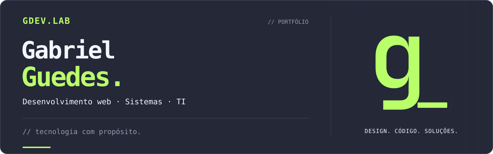

 

**Tecnologia com propósito. Ideias que viram realidade.**

Desenvolvimento web, sistemas e soluções digitais para desafios reais.

 

---

### 

Olá! Sou **Gabriel Guedes**, criador da **GDEV.LAB**, estudante de **Sistemas de Informação (8º semestre)** e profissional de **Tecnologia da Informação** na Bahia, Brasil. 🇧🇷

Atuo na área de TI da **DZSET Transportes desde 2025**, trabalhando com suporte técnico, infraestrutura, conectividade e atendimento às necessidades de diferentes unidades. Em paralelo, desenvolvo aplicações e interfaces web que transformam processos e ideias em soluções digitais.

Meu objetivo é unir **desenvolvimento, usabilidade e visão prática de negócio** para criar experiências intuitivas, organizadas e úteis — independentemente do setor.

> **Do suporte à construção de sistemas:** entender o problema é tão importante quanto escrever o código.

### 

<!-- Ferramentas efetivamente utilizadas em projetos e estudos -->

| Área | Conhecimentos e ferramentas |
| :-- | :-- |
| **Desenvolvimento web** | React, TypeScript, JavaScript, Next.js *(em estudo)*, Tailwind CSS e Vite |
| **Cloud & dados** | Cloudflare Workers, Cloudflare D1, SQLite, Firebase e Firestore |
| **Infraestrutura & suporte** | Hardware, redes, troubleshooting e suporte a usuários |
| **Design & experiência** | Interfaces responsivas, usabilidade, design gráfico e produtividade |

### 

<table>
  <tr>
    <td width="50%" valign="top">
      
      <h3>LG Humanas</h3>
      
<strong>Sistema de avaliação de desempenho</strong>

      
Aplicação corporativa com diferentes perfis de acesso, avaliações, painéis administrativos, acompanhamento de PDI e exportação de dados.

      
<code>React</code> <code>TypeScript</code> <code>Cloudflare Workers</code> <code>D1</code>

      <a href="https://portifolio-guedes.pages.dev/projetos/lg-humanas"><strong>Explorar estudo de caso ↗</strong></a>
    </td>
    <td width="50%" valign="top">
      
      <h3>StressCare</h3>
      
<strong>Plataforma interativa de saúde</strong>

      
Experiência de autoavaliação com coleta anônima, validação de respostas e ambiente administrativo para acompanhamento dos registros.

      
<code>React</code> <code>TypeScript</code> <code>Firebase</code> <code>Firestore</code>

      <a href="https://portifolio-guedes.pages.dev/projetos/stresscare"><strong>Explorar estudo de caso ↗</strong></a>
    </td>
  </tr>
</table>

Os previews acima são mockups ilustrativos, sem dados operacionais ou informações pessoais de terceiros.

### 

Acredito que a tecnologia deve simplificar rotinas e gerar valor. Por isso, meu trabalho conecta desenvolvimento e suporte técnico à **organização de processos, experiência do usuário e necessidades reais de pessoas e empresas**.

**O que posso ajudar a desenvolver:** sites profissionais, portfólios, sistemas web, painéis internos e ferramentas para digitalização de processos — sempre com escopo definido conforme cada projeto.

<strong>🌍 Read this introduction in English</strong>

 

Hi! I'm **Gabriel Guedes**, creator of **GDEV.LAB**, an **8th-semester Information Systems student** and an **IT professional** based in Bahia, Brazil.

I've been working in IT at **DZSET Transportes since 2025**, supporting technical operations, connectivity, infrastructure, and users across different locations. I also build web applications and digital solutions, bringing together **development, usability, and practical business insight**.

My featured projects are **LG Humanas**, a corporate performance-review system, and **StressCare**, an interactive health self-assessment platform. They demonstrate skills I can apply well beyond these industries.

I'm interested in building useful, well-designed software and collaborating on web development opportunities.

**[Explore my bilingual portfolio ↗](https://portifolio-guedes.pages.dev/)**

---

### Vamos transformar sua ideia em algo real?

Conheça minha trajetória, veja meus projetos e entre em contato pelo portfólio.

 

  

GDEV.LAB · Gabriel Guedes · Tecnologia com propósito.

